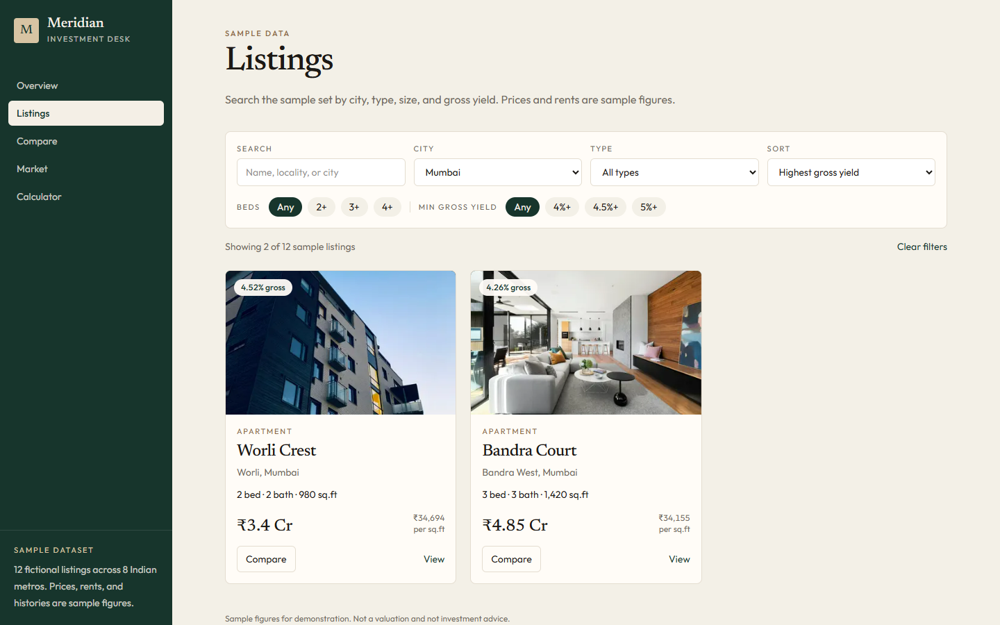
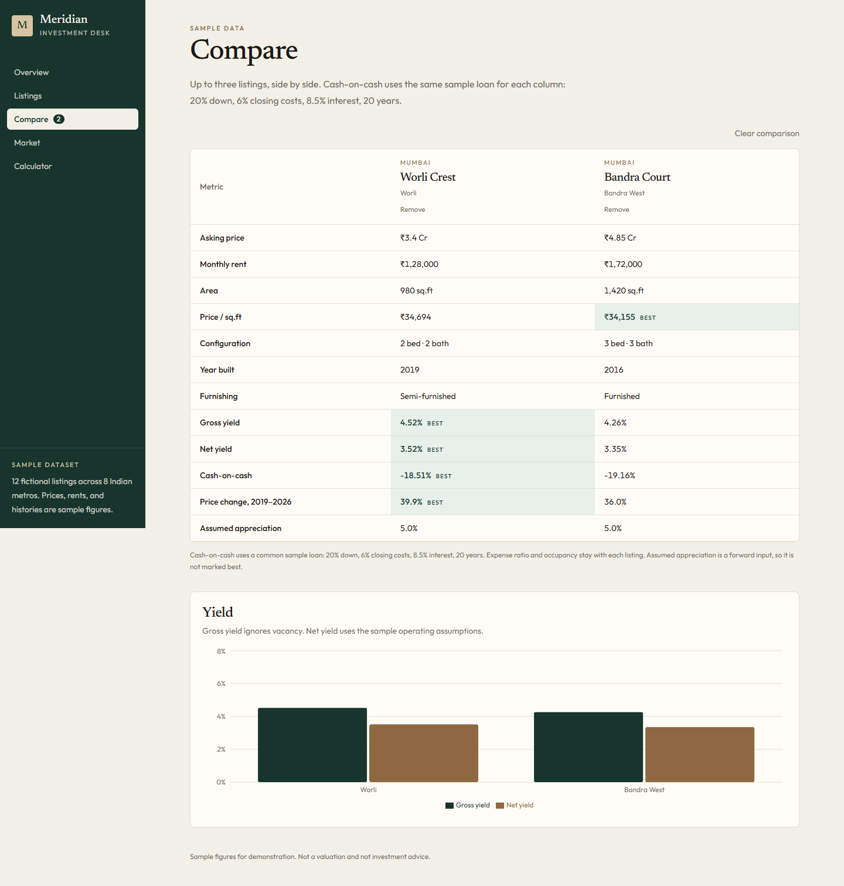
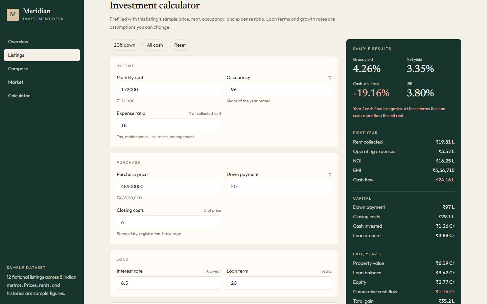
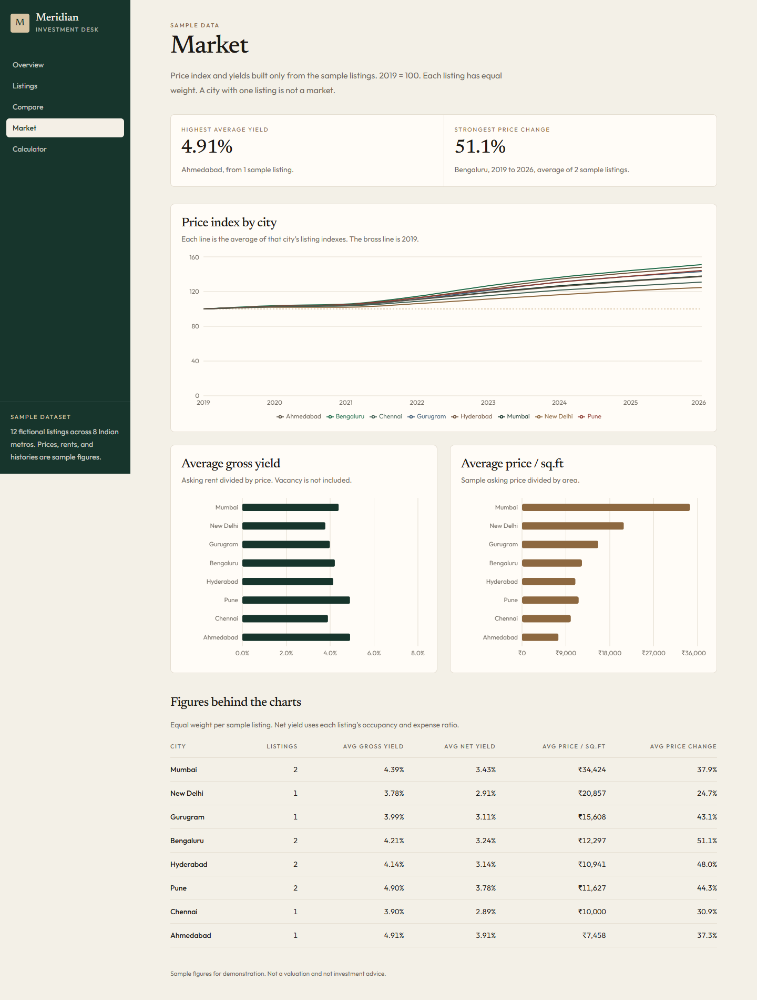

# Real Estate Investment & Market Intelligence Dashboard

Meridian is a sample investment desk for residential property. It lists fictional homes, compares them side by side, calculates rental yield and a hold-period return, and charts the sample price history.

Every price, rent, expense ratio, occupancy rate, and price path is a **sample figure**. Photographs are illustrative stock images, not photos of these listings. Nothing here is a valuation or investment advice.

## Setup

```bash
npm install
npm run dev
```

Open [http://localhost:3000](http://localhost:3000).

The source is at [github.com/badal028/real-estate-investment-dashboard](https://github.com/badal028/real-estate-investment-dashboard). The live demo is [real-estate-investment-dashboard-seven.vercel.app](https://real-estate-investment-dashboard-seven.vercel.app).

```bash
npm test
npm run lint
npm run build
```

## Stack

- Next.js 16 (App Router) and React 19
- TypeScript
- Tailwind CSS 4
- Recharts

Data lives in `src/lib/properties.ts`. There is no database and no sign-in. A comparison stays selected while you move between pages, and clears on refresh.

## Features

- **Listings** — search by name, locality, or city. Filter by city, type, beds, and minimum gross yield. Sort by yield, price, price per sq.ft, or 2019–2026 price change.
- **Comparison** — add up to three listings and read them in one table. The better yield, the lower price per sq.ft, and the stronger sample price change are marked.
- **Calculator** — gross yield, net yield, EMI, year-1 cash flow, cash-on-cash, a year-by-year schedule, exit equity, and IRR. Starts from a listing and every assumption is editable. “20% down” and “All cash” are presets.
- **Market** — a price index (2019 = 100), gross yield by city, and price per sq.ft. Each sample listing has equal weight. City averages with one listing are labeled as such.

## Calculations

Implemented in `src/lib/calculations.ts` and covered by `npm test`.

- **Gross yield** = annual asking rent ÷ price. Vacancy is ignored.
- **NOI** = asking rent × 12 × occupancy × (1 − expense ratio).
- **Net yield** = NOI ÷ price.
- **EMI** = standard monthly amortising payment. A zero interest rate spreads principal evenly.
- **Cash invested** = down payment + closing costs.
- **Year-1 cash flow** = NOI − (EMI × 12).
- **Cash-on-cash** = year-1 cash flow ÷ cash invested.
- Later years: collected rent grows at the rent-growth rate, occupancy stays constant, and debt service stops after the loan term. Property value compounds at the price-growth rate.
- **Exit equity** = future value − remaining loan balance.
- **Total gain** = cumulative cash flow + exit equity − cash invested.
- **IRR** is the annual rate that sets the NPV of cash invested, the operating cash flows, and exit equity to zero.

The comparison table uses one loan for every column: 20% down, 6% closing costs, 8.5% interest, 20 years. Each listing keeps its own expense ratio and occupancy.

Worked example, also asserted in the tests: price ₹10,00,000, rent ₹10,000 a month, full occupancy, 25% expenses, 50% down, no closing costs, 0% interest, 10-year loan, held for one year with no growth.

- Gross yield 12%, NOI ₹90,000, net yield 9%
- EMI ₹4,166.67 a month, year-1 cash flow ₹40,000, cash-on-cash 8%
- Remaining loan ₹4,50,000, equity ₹5,50,000, total gain ₹90,000, IRR 18%

## Screenshots

Listings filtered to Mumbai:



Side-by-side comparison:



Investment calculator on a sample listing:



Market charts:



## Project layout

```
src/app                pages
src/components         UI
src/lib/properties.ts  sample listings
src/lib/calculations.ts  yield and return
src/lib/market.ts      index and city averages
public/properties      illustrative photos
```
